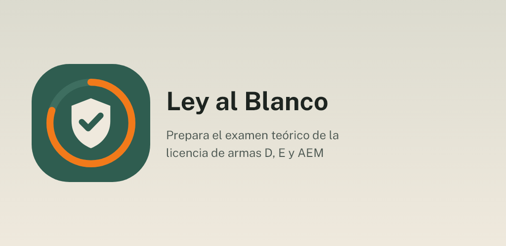

[English](README.md) · **Español**

  

# Ley al Blanco

Prepara el examen teórico de las licencias de armas D y E y la autorización
especial para menores (AEM) en España. Las **423 preguntas del cuestionario**,
con explicaciones, teoría y simulacros para estudiar a tu ritmo.

**Gratis · Sin anuncios · Sin cuenta · Funciona sin conexión · Código abierto**

## Descargas

  
  
  <!--
  
  -->

Android ya; iOS próximamente. Todos los temas y modos están abiertos, con modo
claro y oscuro.

Únete a la beta de Google Play

La app está en prueba cerrada en Google Play y cualquiera puede apuntarse:

1. Únete al grupo de testers: [ley-al-blanco-testers](https://groups.google.com/g/ley-al-blanco-testers). Con tu cuenta de Google, pulsa «Unirse al grupo».
2. Acepta la prueba desde el móvil o el ordenador: [play.google.com/apps/testing/es.leyalblanco.app](https://play.google.com/apps/testing/es.leyalblanco.app).
3. Instala la app desde Google Play. Se actualizará sola.

Si puedes, quédate en la prueba al menos 14 días y úsala de vez en cuando (por ejemplo, la pregunta del día): Google exige 12 testers durante 14 días para publicarla para todo el mundo. Los comentarios, a dev@mainshai.com.

Instala el APK desde GitHub

1. Descarga el APK de tu móvil desde la [última versión](https://github.com/dferrandizmont/ley-al-blanco/releases/latest):
   - `Ley-al-Blanco-vX.Y.Z-arm64-v8a.apk`: para casi todos los móviles actuales.
   - `Ley-al-Blanco-vX.Y.Z-armeabi-v7a.apk`: para móviles antiguos de 32 bits.
2. Al abrir el APK hay que permitir «instalar aplicaciones de origen desconocido».
3. Comprobación de integridad: el fichero `SHA256SUMS.txt` publicado en la misma página de la versión.

## Capturas

  
  
  
  
  

Más capturas

  
  
  
  

Pulsa una captura para ampliarla.

## Funciones

- **Práctica por temas.** Explicaciones y referencias a la normativa.
- **Simulacros ilimitados.** 20 preguntas, apto con 16 aciertos, historial y revisión.
- **Repaso de fallos.** Repetición espaciada, pregunta del día y racha de estudio.
- **Teoría y glosario.** Teoría, glosario, buscador y tarjetas de cifras y plazos.
- **Progreso local.** Exportar e importar el progreso con el selector de archivos del sistema.

## Privacidad

Nada sale del móvil y la app no pide permisos. Sin servidor, analítica ni
servicios de terceros. El progreso se guarda en el dispositivo; los enlaces
externos, el correo y la exportación solo se abren por acción del usuario.

[Política de privacidad](https://dferrandizmont.github.io/ley-al-blanco/privacidad/).

## Novedades

Lo que cambia en cada versión está en [CHANGELOG.md](CHANGELOG.md) y en las
[versiones publicadas](https://github.com/dferrandizmont/ley-al-blanco/releases).

## Contribuir

Son bienvenidos los informes de errores, las ideas y las traducciones. Cómo
compilar, probar y contribuir: [CONTRIBUTING.es.md](CONTRIBUTING.es.md).

## Licencia

Código [MIT](LICENSE), Copyright (c) 2026 Daniel Mont Ferrandiz.
Explicaciones, teoría y glosario propios: [CC BY-SA 4.0](LICENSE-CONTENT.md).

Las preguntas, opciones y respuestas proceden de la **Dirección General de la
Guardia Civil** y se reutilizan conforme a la **Ley 37/2007**, fuera de MIT y CC.
Se conservan los [PDF, fechas y checksums](fuentes/guardia-civil/LEEME.md).
Los textos normativos del [BOE](fuentes/boe/LEEME.md) no tienen derechos de autor
(art. 13 LPI). Los materiales de terceros conservan sus licencias.

Para avisos de seguridad: [SECURITY.md](SECURITY.md).

App independiente y no oficial, sin afiliación con la Guardia Civil ni con
ninguna administración. El material ayuda a estudiar y no sustituye la normativa
vigente ni las indicaciones del órgano examinador.
