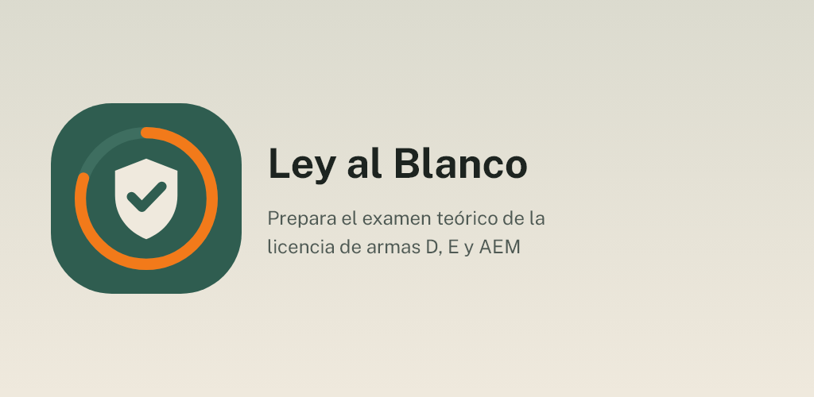
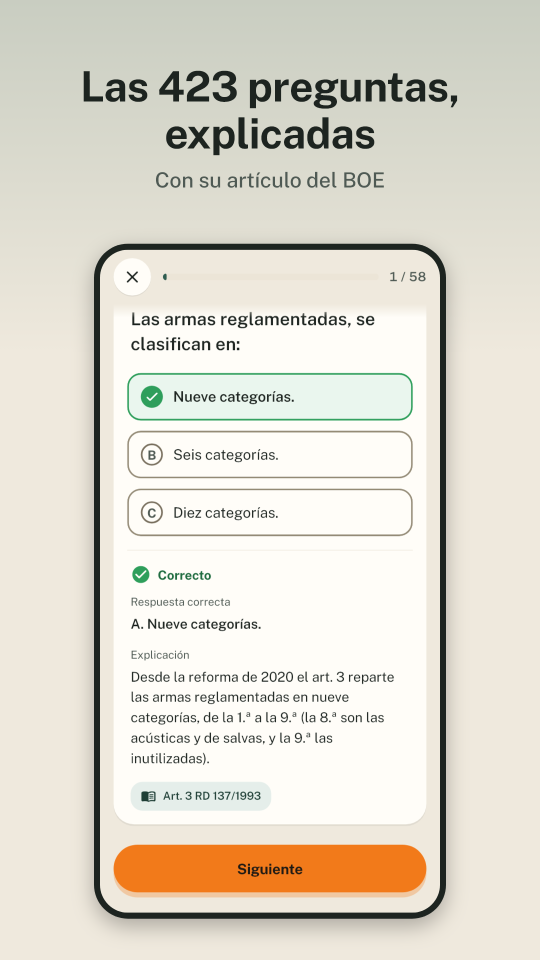
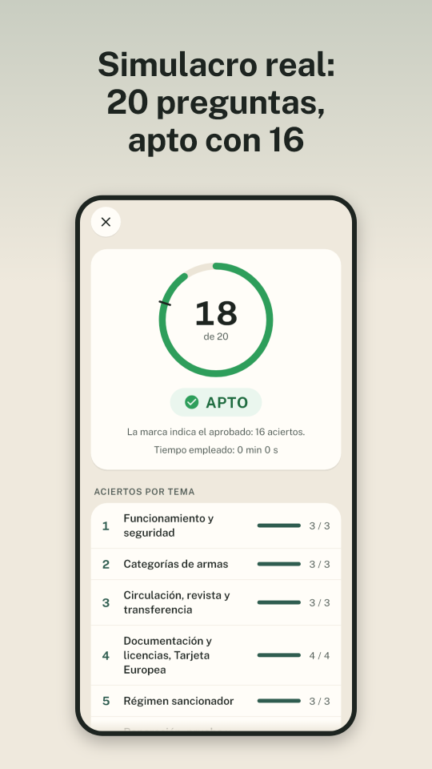
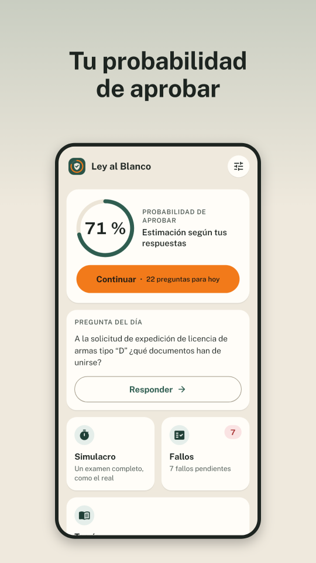
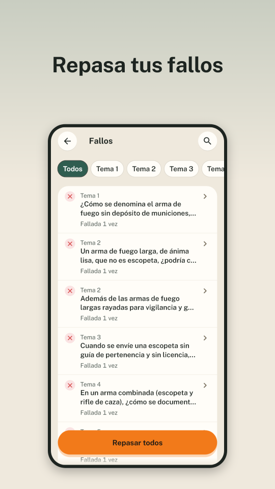
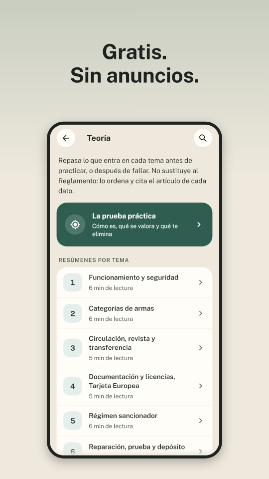

<p align="center">
  
</p>

# Ley al Blanco

[](LICENSE)
[](LICENSE-CONTENT.md)
[](https://github.com/dferrandizmont/ley-al-blanco/releases/latest)
[](https://github.com/dferrandizmont/ley-al-blanco/releases)

Prepara el examen teórico de las licencias de armas D y E y la autorización
especial para menores (AEM) en España. Las **423 preguntas del cuestionario**,
con explicaciones, teoría y simulacros para estudiar a tu ritmo.

**Gratis, sin anuncios, sin cuenta y sin conexión.** Todos los temas y modos
están abiertos. Para Android (iOS, próximamente), con modo claro y oscuro.

## Descargas

<p>
  <a href="https://github.com/dferrandizmont/ley-al-blanco/releases"></a>
  <!--
  <a href="[ENLACE_BETA_PLAY]"></a>
  <a href="[ENLACE_APP_STORE]"></a>
  -->
</p>

Próximamente en Google Play y App Store.

## Capturas

<p>
  <a href="docs/readme/01-preguntas-explicadas.png"></a>
  <a href="docs/readme/02-simulacro.png"></a>
  <a href="docs/readme/03-probabilidad.png"></a>
  <a href="docs/readme/04-fallos.png"></a>
  <a href="docs/readme/05-gratis.png"></a>
</p>

Pulsa una captura para ampliarla.

## Funciones

- Práctica por temas con explicaciones y referencias a la normativa.
- Simulacros ilimitados de 20 preguntas: aprobado con 16 aciertos, historial y revisión.
- Repaso de fallos y repetición espaciada, pregunta del día y racha de estudio.
- Teoría, glosario, buscador y tarjetas de cifras y plazos.
- Progreso local que puedes exportar e importar con el selector de archivos del sistema.

## Privacidad

Nada sale del móvil y la app no pide permisos. Sin servidor, analítica ni
servicios de terceros. El progreso se guarda en el dispositivo; los enlaces
externos, el correo y la exportación solo se abren por acción del usuario.

[Política de privacidad](https://dferrandizmont.github.io/ley-al-blanco/privacidad/).

## Compilar y probar

Requisitos: Flutter **3.47.7**, Android SDK para Android o macOS con Xcode para
iOS. La app usa Riverpod, go_router y Drift para el estado, la navegación y la
base de datos local.

Desde la raíz:

```bash
cd app
flutter pub get
flutter analyze
flutter test
flutter run
```

APK de pruebas locales, sin `app/android/key.properties`:

```bash
flutter build apk --release -PallowDebugSigning=true
```

Usa la clave de depuración de la máquina. Los APK públicos requieren una clave
del dueño fuera del repositorio: [firma de release](docs/release-signing.md).
Los ficheros generados se versionan; si cambias sus fuentes:

```bash
dart run build_runner build -d
flutter gen-l10n
```

Para regenerar el contenido hacen falta Python **3.11 o superior** y `pdftotext`
(Poppler o Xpdf). Sigue el [pipeline de contenido](tool/content/README.md);
no edites los JSON generados a mano. El banco se comprueba con SHA-256 al importarlo.

[Pruebas en dispositivo](docs/qa.md) ·
[Regenerar gráficos y capturas](tool/store/LEEME.md) ·
[Especificación](licencia-armas-spec.md) · [Diseño](docs/design-sereno.md).

## Licencias y fuentes

Código [MIT](LICENSE), Copyright (c) 2026 Daniel Mont Ferrandiz.
Explicaciones, teoría y glosario propios: [CC BY-SA 4.0](LICENSE-CONTENT.md).

Las preguntas, opciones y respuestas proceden de la **Dirección General de la
Guardia Civil** y se reutilizan conforme a la **Ley 37/2007**, fuera de MIT y CC.
Se conservan los [PDF, fechas y checksums](fuentes/guardia-civil/LEEME.md).
Los textos normativos del [BOE](fuentes/boe/LEEME.md) no tienen derechos de autor
(art. 13 LPI). Los materiales de terceros conservan sus licencias.

Para avisos de seguridad: [SECURITY.md](SECURITY.md).

App independiente y no oficial, sin afiliación con la Guardia Civil ni con
ninguna administración. El material ayuda a estudiar y no sustituye la normativa
vigente ni las indicaciones del órgano examinador.
