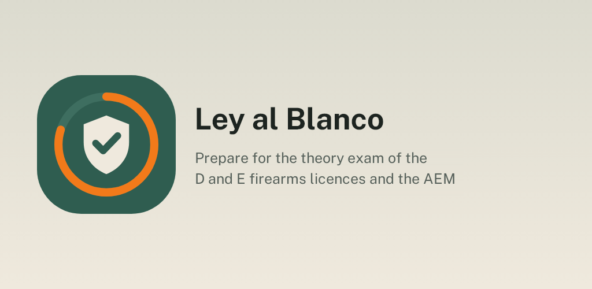
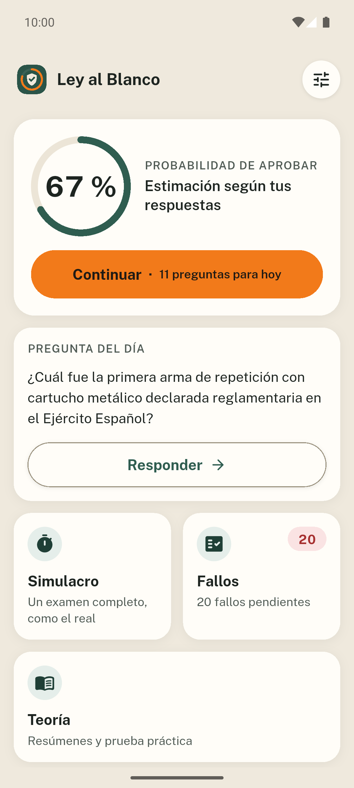
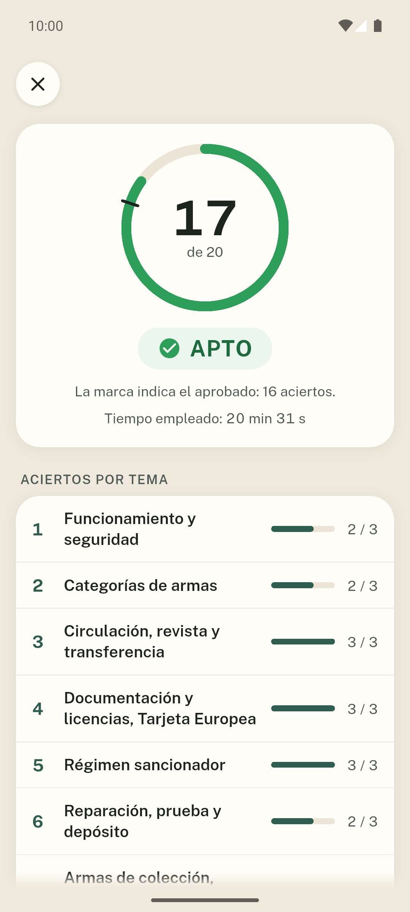
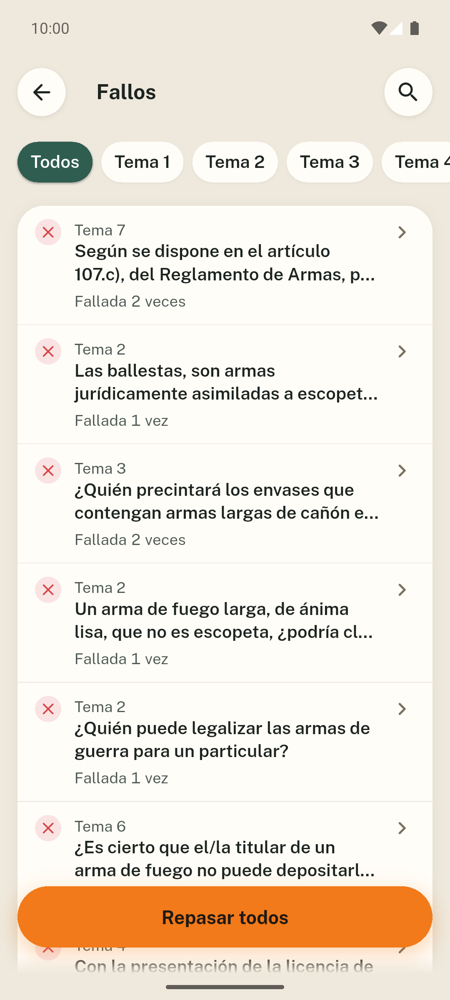
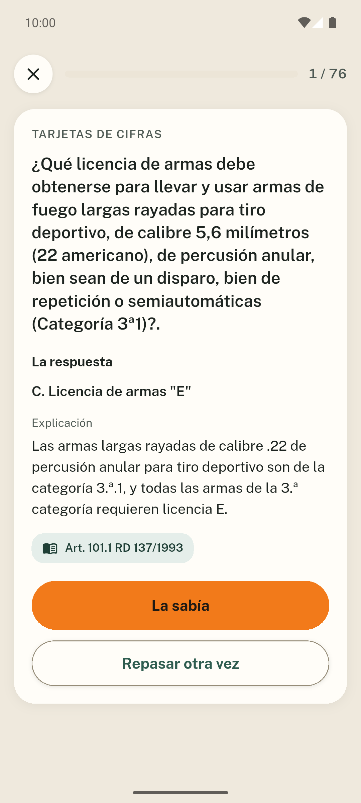
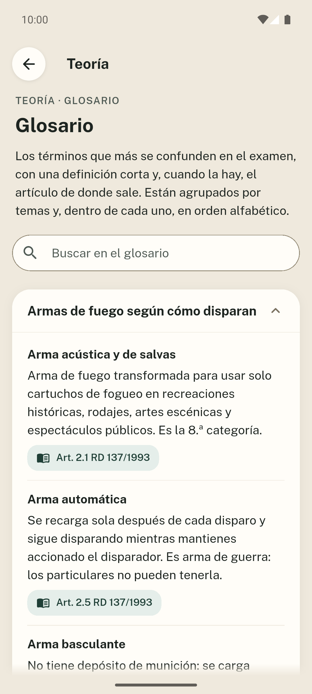
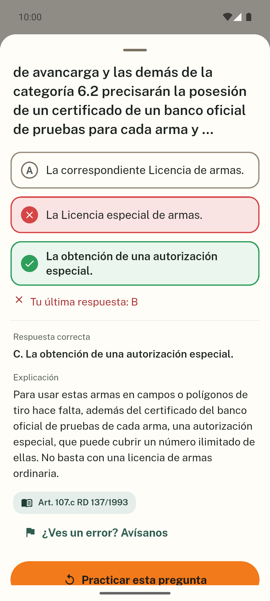
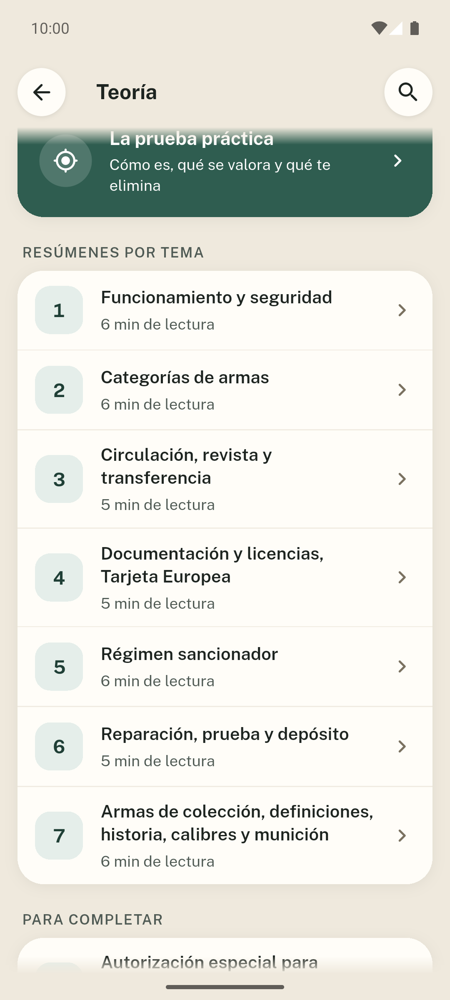
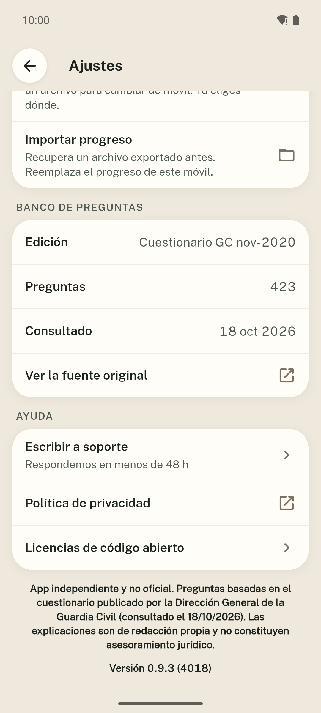
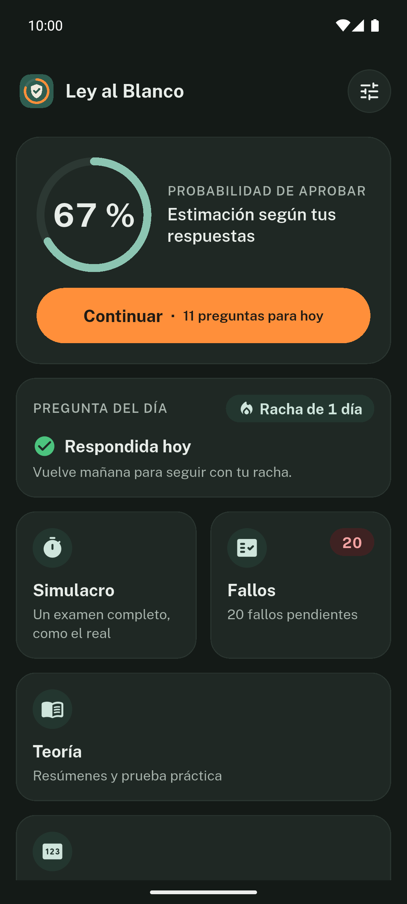

**English** · [Español](README.es.md)

  

# Ley al Blanco

Ley al Blanco helps you prepare for the Spanish firearms licence theory exam
(D and E) and for the special authorisation for minors (AEM). It includes the
423 official questions, with explanations, theory and mock exams to study at
your own pace. The app is in Spanish.

**Free · No ads · No account · Works offline · Open source**

## Download

  
  
  <!--
  
  -->

Android now, iOS coming soon. Every topic and mode is open, with a light and a
dark theme.

Join the beta on Google Play

The app is in closed testing on Google Play and anyone can join:

1. Join the testers group: [ley-al-blanco-testers](https://groups.google.com/g/ley-al-blanco-testers). Sign in with your Google account and press «Join group».
2. Accept the test from your phone or computer: [play.google.com/apps/testing/es.leyalblanco.app](https://play.google.com/apps/testing/es.leyalblanco.app).
3. Install the app from Google Play. It updates itself.

If you can, stay in the test for at least 14 days and use it from time to time (for example, the daily question): Google requires 12 testers for 14 days to publish it for everyone. Send comments to dev@mainshai.com.

Install the APK from GitHub

1. Download the APK for your phone from the [latest release](https://github.com/dferrandizmont/ley-al-blanco/releases/latest):
   - `Ley-al-Blanco-vX.Y.Z-arm64-v8a.apk`: for almost all current phones.
   - `Ley-al-Blanco-vX.Y.Z-armeabi-v7a.apk`: for older 32-bit phones.
2. When you open the APK, allow «install apps from unknown sources».
3. Check the integrity with the `SHA256SUMS.txt` file published on the same release page.

## Screenshots

  
  
  
  
  

More screenshots

  
  
  
  

Tap a screenshot to enlarge it.

## Features

- **Practice by topic.** Explanations and references to the rules.
- **Unlimited mock exams.** 20 questions, pass with 16 correct answers, history and review.
- **Review your mistakes.** Spaced repetition, daily question and study streak.
- **Theory and glossary.** Theory, glossary, search and cards with figures and deadlines.
- **Local progress.** Export and import your progress with the system file picker.

## Privacy

Nothing leaves your phone and the app asks for no permissions. No server, no
analytics and no third-party services. Your progress is stored on the device;
external links, email and export only open when you ask for them.

[Privacy policy](https://dferrandizmont.github.io/ley-al-blanco/privacidad/).

## What's new

See [CHANGELOG.md](CHANGELOG.md) or the [releases](https://github.com/dferrandizmont/ley-al-blanco/releases).

## Contributing

Bug reports, ideas and translations are welcome. How to build, test and
contribute: [CONTRIBUTING.md](CONTRIBUTING.md).

## License

Code [MIT](LICENSE), Copyright (c) 2026 Daniel Mont Ferrandiz. Our original explanations,
theory and glossary: [CC BY-SA 4.0](LICENSE-CONTENT.md).

The questions, options and answers come from the **Dirección General de la
Guardia Civil** and are reused under **Ley 37/2007**, outside MIT and CC. The
[PDFs, dates and checksums](fuentes/guardia-civil/LEEME.md) are kept. The legal
texts of the [BOE](fuentes/boe/LEEME.md) have no copyright (art. 13 LPI).
Third-party materials keep their own licences.

For security reports: [SECURITY.md](SECURITY.md).

Independent and unofficial app, with no affiliation with the Guardia Civil or
with any administration. The material helps you study and does not replace the
rules in force or the instructions of the examining body.
